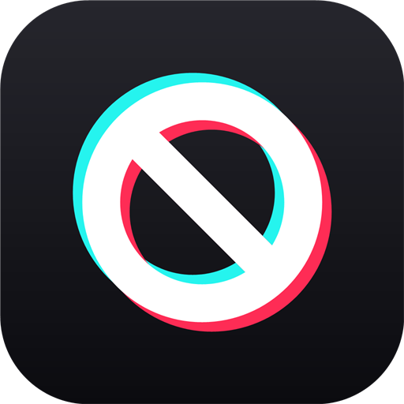

  

<h1 align="center">Banish</h1>

<b>Quick block for TikTok</b>: one click marks a video <i>Not interested</i> and blocks its account.

Idea &amp; design by <b>LeerBox</b>

  
  
  

<a href="https://github.com/LeerBox/banish/releases/latest"><b>⬇ Download the latest version</b></a>

---

## Features
- **One-click cleanup.** Marks the video *Not interested* so TikTok shows less like it, then blocks the account.
- **Buttons in the right places.** They appear wherever accounts show up, and never sit on top of TikTok's own controls.
- **Auto-skip.** Videos from accounts you've already blocked are skipped in the feed.
- **Dimmed comments.** Comments from blocked accounts fade out.
- **Keyboard shortcut.** <kbd>Alt</kbd> + <kbd>B</kbd> blocks the author of the video on screen.
- **Popup.** Settings and a list of recently blocked accounts.

## Where the button appears
| Place | Position |
|---|---|
| For You / Following / video page | Top edge of the video, just left of TikTok's `⋯` button. Expands to "Not interested + Block" on hover. |
| Comments & replies | Small ⊘ next to the username (shows on hover). |
| Profile page | "Block" button next to the `⋯` button in the header. |
| Search results | ⊘ next to the author name on each card. |
| LIVE: host | Round ⊘ button next to TikTok's share button in the stream header. |
| LIVE: chat | Small ⊘ next to each chatter's name (shows on hover). |
| LIVE cards in the feed | "LIVE now · Following · ⊘ Banish" on the stream preview. |
| New full-width player | "⊘ Banish" next to the creator's name and Follow. |
| Everywhere else | Any username link (Explore, follower lists, notifications, search Users tab, sidebar): ⊘ next to the name, or on the card's right edge. |

## Install
1. Download **banish-vX.Y.Z.zip** from the [latest release](https://github.com/LeerBox/banish/releases/latest) and unzip it.
2. Open `chrome://extensions` (or `edge://extensions`).
3. Turn on **Developer mode**.
4. Click **Load unpacked** and pick the folder.
5. Reload any open TikTok tab.

## How blocking works
Banish opens the account's profile in a hidden same-origin frame and clicks TikTok's own
`⋯ → Block → Block` buttons. If that fails, it retries in a background tab that closes itself.
"Not interested" uses the native option from the video's `⋯` menu (videos only).
Nothing is sent anywhere else: the list of blocked accounts stays in your browser.

## Notes
- Set TikTok's language to **English**: the block flow finds buttons by their text ("Block" / "Unblock").
- To unblock someone, open their profile on TikTok and press **Unblock**.
- Banish is an independent project and is not affiliated with TikTok or ByteDance.

## Releasing (maintainers)
1. Bump `version` in `manifest.json`.
2. Add a `## [x.y.z] - date` section at the top of `CHANGELOG.md`.
3. Commit, then tag and push: `git tag vx.y.z && git push origin vx.y.z`.

GitHub Actions checks the version, validates the code, builds `banish-vx.y.z.zip` with a SHA-256 checksum,
and publishes the release with notes taken from the changelog. Tags with a suffix (e.g. `v1.1.0-beta.1`) become pre-releases.

## Privacy
Banish collects nothing. See the [privacy policy](PRIVACY.md).

## Author
Created by **LeerBox**: idea, concept and design.

## License
[MIT](LICENSE) © LeerBox
